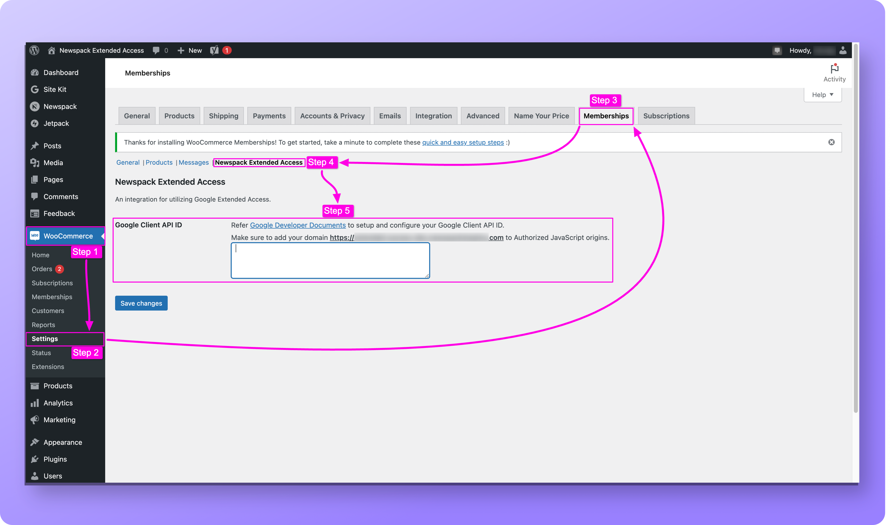

# Newspack Extended Access

Google Extended Access integration wrapper plugin for Newspack. The plugin enables readers to unlock free access to select paywalled articles on registration.

Read more about [Google Extended Access](https://developers.google.com/news/subscribe/extended-access/integration-steps/get-started) (requires an eligible Google user to be signed in).


## Dependency

This plugin requires the [Newspack Plugin](https://github.com/Automattic/newspack-workspace/tree/main/plugins/newspack-plugin), installed, configured and active, plus one content gating system:
- **Newspack Access Control.** Reporting subscription start dates to Google needs Newspack Plugin 6.56.0 or later, with [WooCommerce Subscriptions](https://woocommerce.com/products/woocommerce-subscriptions/) providing the subscriptions.
- **WooCommerce Memberships.** This needs [WooCommerce](https://github.com/woocommerce/woocommerce) and [WooCommerce Memberships](https://woocommerce.com/products/woocommerce-memberships/).

## Configuration

This plugin requires a valid `Google Client API ID` specific to your Newspack Site domain. Please create a new `Google Client API ID` for your site, if not already created. Follow the instructions in [Setting up Google Client API ID](https://developers.google.com/identity/gsi/web/guides/get-google-api-clientid).

> Make sure [dependent plugins](#dependency) are installed, configured and active on your site.

### Setting up Google Client API ID

Log in to the site dashboard as an `Administrator`:
1. Open the `Settings` menu.
2. Select `Extended Access`.
3. Add the `Google Client API ID`.
4. Add the domain shown on the page to Authorized JavaScript origins in the Google client.

Sites with WooCommerce Memberships can also use `WooCommerce` > `Settings` > `Memberships` > `Newspack Extended Access`, shown below. Both screens save the same setting.



## Reader accounts

The `sub` claim in Google's ID token identifies a reader, so an account stays linked to its Google Account when the address changes.

- A new account starts verified when [Google is authoritative](https://developers.google.com/identity/gsi/web/guides/verify-google-id-token) for the address: a Gmail address, or a verified address on a Workspace or Cloud hosted domain. Other new accounts stay unverified until the reader confirms the address by email.
- An existing account can be linked on the same condition, unless it is linked to another Google Account. Otherwise the reader goes to the login page, to sign in with the account's password or a magic link.
- Linking leaves the account's verification state alone, because someone else could have created the account and still hold its password.
- Verifying an account ends its link. A Google Account that Google is authoritative for links again on its next sign-in.
- Google sign-in only opens reader accounts. Administrators and editors are refused by default, and `newspack_reader_restricted_roles` changes that list.

## Compatibility

The plugin excludes its scripts from the Perfmatters Delay JS and Defer JS settings. Without this, the registration wall waits for the first reader interaction on sites that delay all scripts.

## Testing

Google's script only starts Extended Access when two conditions hold:
- The URL has `gaa_at`, `gaa_n`, `gaa_sig`, and `gaa_ts`, and `gaa_ts` is a Unix timestamp in the future, in hexadecimal.
- The referrer is empty, an https Google domain, or a host the plugin allows. The plugin allows the site's own host.

A link from any other site does nothing. To open the registration wall without a Showcase link:

1. Log out. A logged-in reader does not see the registration wall.
2. Open any page on the site.
3. Open the browser console.
4. Run this, with the article URL in place of `<article>`. If the URL already has a query string, change the first `?` to `&`.

```js
location.href = '<article>?gaa_at=la&gaa_n=test&gaa_sig=test&gaa_ts=' + ( Math.floor( Date.now() / 1000 ) + 3600 ).toString( 16 ) + '#swg.debug=1';
```

The registration wall appears. `#swg.debug=1` turns on Google's logging in the console.

These values reach the registration wall and sign-in only. Google sends `gaa_n` to its servers as the metering token, so with a test value it returns `{"entitlements":[]}`. The call to action and metered grants need a real signed Showcase link.

## Supported content

Extended Access is offered on single posts. Gated pages and custom post types get neither the schema Google's crawler reads nor the Extended Access scripts, so readers see the publisher's own paywall on them instead.

To include other content types, filter the check:

```php
add_filter( 'newspack_extended_access_can_insert_frontend_markup', function( $can_insert ) {
	return $can_insert || is_singular( 'my-custom-post-type' );
} );
```

## License

Newspack Extended Access is licensed under [GNU General Public License v3 (or later)](./LICENSE).
